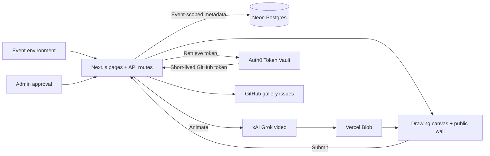

# Party Animals

Draw an animal, bring it to life with AI, and curate a public wall. Approved animals become GitHub gallery issues using Auth0 Token Vault. One Vercel project and its environment variables represent one event — no source edits required.

## Set up a new event

- Create a new Vercel project from this repository, or update an existing project's environment.
- Copy `.env.example` for local development and configure the same variables in Vercel. Set a unique lowercase, hyphenated `EVENT_SLUG`, plus `EVENT_NAME`, `EVENT_URL`, `EVENT_BRAND_HOST`, `EVENT_BRAND_SHORT_NAME`, `EVENT_TAGLINE`, and `EVENT_SITE_URL` for your deployment.
- Set `GITHUB_ISSUE_REPO` and `EVENT_ISSUE_LABEL`. The posting account needs permission to create issues in that repository.
- Replace **all** `ADMIN_*` defaults with your organizers (or empty strings to disable grants). These are independent, additive grants, including legacy display-name matching; prefer exact logins/emails and disable name matching for stricter access.
- Provision Neon and Vercel Blob; set `DATABASE_URL`, `PARTY_ANIMAL_BLOB_READ_WRITE_TOKEN`, and `XAI_API_KEY`.
- Configure Auth0 credentials, `AUTH0_SECRET`, and `APP_BASE_URL`. Allow the deployment's `/auth/callback` URL and logout origin in Auth0. Configure a GitHub-backed connection with Token Vault/connected accounts and refresh tokens, setting `AUTH0_TOKEN_VAULT_CONNECTION` if its name differs from `github`.
- Optionally run `pnpm db:setup` against your intended database. The app also creates/migrates its schema on its first database operation. The DB role needs table/index creation and alteration privileges.
- Redeploy after environment changes, then log in and connect GitHub on `/settings`. Submit on `/draw`, review on `/wall`, and approve posting as an admin.

Login and Token Vault can use different Auth0 connections. `AUTH0_LOGIN_CONNECTION` defaults to `AUTH0_TOKEN_VAULT_CONNECTION` (`github`), preserving the GitHub login flow. For an email/password-only preview client, set `AUTH0_LOGIN_CONNECTION=Username-Password-Authentication` (or an empty string for Universal Login to choose). Leave `AUTH0_TOKEN_VAULT_CONNECTION=github` for GitHub Connect/posting. Preview `APP_BASE_URL` must match the exact hostname used to sign in and call the API; register its `/auth/callback` with the Auth0 client. Session cookies are host-only by default: logging in on another deployment URL does not authenticate the branch alias.

### Fresh wall / reset

Admins can use **Settings → CONFIGURE APP** to change the event slug, name, URL, brand host/short name, tagline, site URL and issue label without redeploying. Only overrides are saved in Neon's singleton `app_settings` row; empty fields fall back to environment variables and then built-in defaults. **Reset to env defaults** clears saved overrides. Reads fall back to the environment if Neon is unavailable. All other settings below remain environment-only.

Changing the slug starts a fresh wall: all queries (including by-ID mutations) are scoped to that slug, and earlier events remain intact. Legacy rows are always migrated to `ai-world-fair-2026`, not whichever new slug runs the migration first. The reset script uses the effective saved slug too.

To permanently delete **only the current event's rows**, run `pnpm event:reset --yes`. Without `--yes` it refuses before connecting. Verify `DATABASE_URL` and `EVENT_SLUG` first. This does **not** delete blobs or GitHub issues. New uploads use `events/<slug>/animals/`; manage Blob retention separately. Switching back to an earlier slug restores its wall unless its rows were deleted.

## Environment variables

All event defaults live in `lib/event.ts`; only public branding/links are passed from the server layout to client components. Secrets and admin settings stay on the server. `.env.example` lists all application variables.

| Variable | Default / purpose |
| --- | --- |
| `EVENT_SLUG` | `ai-world-fair-2026`; data partition and blob prefix |
| `EVENT_NAME`, `EVENT_URL` | `AI World Fair 2026`, `https://www.ai.engineer/worldsfair/2026`; issue footer |
| `EVENT_BRAND_HOST`, `EVENT_BRAND_SHORT_NAME` | `Auth0`, `AIE`; header, hero, metadata, drawing title |
| `EVENT_TAGLINE` | `AI Engineer · San Francisco`; hero caption |
| `EVENT_DESCRIPTION` | Derived from brand; metadata description |
| `EVENT_SITE_URL` | Origin; falls back to `APP_BASE_URL`, then `https://party-animals-xi.vercel.app`; derives `/draw` and `/wall` |
| `NEXT_PUBLIC_WALL_URL` | Optional legacy override for issue wall links |
| `GITHUB_ISSUE_REPO` | `focusotter/party-animals-gallery` |
| `EVENT_ISSUE_LABEL` | `ai-world-fair` |
| `EVENT_VIDEO_PROMPT` | Original fun/bouncy animation prompt (see `.env.example`) |
| `DATABASE_URL` | Required Neon Postgres URL |
| `AUTH0_DOMAIN`, `AUTH0_CLIENT_ID`, `AUTH0_CLIENT_SECRET` | Required Auth0 application credentials |
| `AUTH0_SECRET`, `APP_BASE_URL` | Required session encryption secret and application origin |
| `AUTH0_TOKEN_VAULT_CONNECTION` | `github`; GitHub-backed Auth0 login/connected-account connection |
| `ADMIN_GITHUB_LOGIN` | `mtliendo,focusotter`; comma-separated login grants |
| `ADMIN_EMAIL` | Empty; comma-separated email grants |
| `ADMIN_EMAIL_DOMAIN` | `focusotter.com`; domain grant, empty disables |
| `ADMIN_NAMES` | `focus otter`; exact display-name grants |
| `ADMIN_NAME_CONTAINS` | `moises,liendo`; display-name substring grants |
| `XAI_API_KEY` | Required for video generation |
| `XAI_VIDEO_MODEL` | Optional preferred model; falls back to `grok-imagine-video`, then `grok-imagine-video-1.5` |
| `PARTY_ANIMAL_BLOB_READ_WRITE_TOKEN` | Required Vercel Blob token |
| `GITHUB_POSTING_TOKEN` | Optional server-side posting fallback |

Token Vault is preferred. Existing login-claim/social-identity and server-token fallbacks remain supported. Changing the connection name must still point to a **GitHub** provider; this does not change the publishing platform.

## Local development

Use Node.js 22+ and pnpm.

```sh
pnpm install
cp .env.example .env.local
# Fill in credentials and event settings in .env.local
pnpm db:setup # optional; loads .env.local like Next.js
pnpm dev
```

Open http://localhost:3000. Auth0 must allow the local callback URL. Keep `.env.local` untracked. Tests require no database or credentials:

```sh
pnpm lint
pnpm test
pnpm build
```

## Architecture

